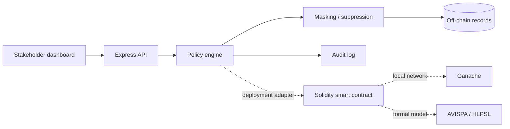

# EHealth Access Control

> Formal-policy thinking and blockchain auditability for privacy-preserving e-health access.

[](https://github.com/LouayHM3/ehealth-access-control/actions/workflows/ci.yml) [](https://codespaces.new/LouayHM3/ehealth-access-control)

This project is a portfolio implementation of an inference-based access-control framework for IoT-enabled e-health systems. It makes the central security decision visible: an access request is evaluated by stakeholder role, data category, attribute, consent, and legal context, then the response is visible, transformed, or suppressed.

The default demo is safe and deterministic. It uses synthetic patient data, an in-process policy engine, and a simulated transaction hash. It never stores real health data and does not require Ganache to explore the workflow. The Solidity contract and HLPSL artifact show the on-chain and formal-validation boundaries for an extended deployment.

## Run it

```bash
npm install
npm test
npm start
```

Open <http://localhost:3000>. Try the same attribute with `Patient`, `Researcher`, `Patient family`, and `Legal system` roles. Toggle consent or legal order to observe the policy change.

### Docker

```bash
docker compose up --build
```

## Architecture



## Policy model

| Context | Example decision |
| --- | --- |
| Patient requests identity | Visible |
| Researcher requests full name | Pseudonymized |
| Researcher requests birth date | Generalized |
| Insurance requests phone | Suppressed |
| Family requests clinical data without consent | Denied |
| Legal system without verified order | Denied |

The demo policy is centralized in `policy.js` so the same decision contract can be tested independently, exposed by HTTP, or translated into Solidity.

## Formal validation boundary

`formal/goal1_confidentiality.hlpsl` is a reference HLPSL model for a baseline confidentiality claim. It is intentionally included as a reviewable artifact rather than pretending AVISPA is installed in every environment. The academic specification describes three validation goals: baseline confidentiality, irreversible masked exposure, and malicious-insider resistance.

## Production boundary

A production deployment would replace the demo adapters with Solidity deployment through Web3 or ethers, Ganache for local integration testing, authenticated JWT middleware, encrypted off-chain storage, consent persistence, key management, and a complete AVISPA model suite. Sensitive health information must remain off-chain and must never be committed to this repository.

## Project map

```text
policy.js                         Role/category/attribute inference and masking
server.js                         Express API and audit event boundary
contracts/EHealthAccess.sol       Solidity policy and AccessLogged event
formal/goal1_confidentiality.hlpsl AVISPA/HLPSL reference model
public/                           Policy console UI
 test/policy.test.js              Deterministic access-control tests
```

`Node.js` · `Express` · `Solidity` · `Ganache boundary` · `HLPSL` · `AVISPA` · `privacy-preserving masking` · `auditability`
